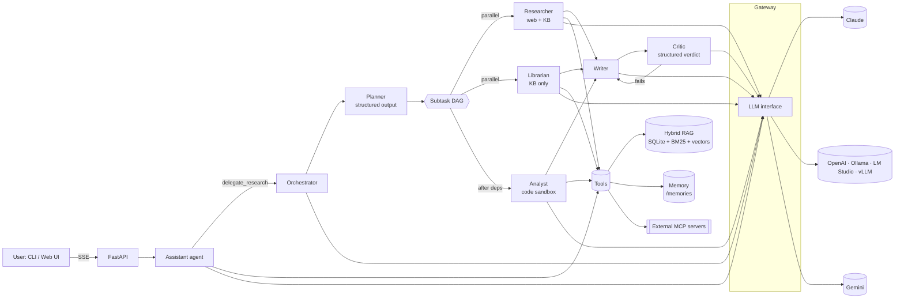

# Atlas: Provider-Agnostic Multi-Agent Research Platform

Atlas is a production-style agentic AI system built on the Model Context Protocol (MCP) that runs on **Claude, OpenAI, Gemini, or a local model** (Ollama, LM Studio, vLLM, llama.cpp or any OpenAI-compatible server). You choose the provider by setting an API key. It answers questions from your private documents and the live web. For a big question it brings in a team of specialist agents that plan the work, research in parallel, analyse data in a sandbox, write a report, review it, and revise it.

It was built to show how real agent systems work end to end: a hand-written agent loop, typed tools, MCP in both directions (as server and as client), hybrid RAG with native citations, long-term memory, multi-agent orchestration, reflection, human approval gates, guardrails, tracing, cost control, evals, a streaming web UI, Docker and CI. There's no framework hiding the hard parts. Each concept lives in a small module you can read in one sitting.

Illustrative run (the shape of the console output; your numbers will differ):

```
you › Compare Nimbus Growth vs Enterprise for a 40-person startup, including SLA risk and 12-month cost.

▶ librarian:t1   Collect plan pricing & discounts
▶ researcher:t2  Collect SLA terms and support levels           (parallel)
▶ analyst:t3     Model 12-month cost incl. overages             (waits for t1, t2)
■ writer         Draft report
  Critique round 1: 6/10 - revising  (missing downtime-minutes comparison)
  Critique round 2: 9/10 passes
cost $0.41 · 14 model calls · cache hit 71% · trace 3f9c…
```

---

## What it demonstrates

| Area | What's implemented | Where |
|---|---|---|
| **Any LLM provider** | One `LLM` interface with adapters for Claude (native), Gemini (native, with thought-signature round-tripping) and anything OpenAI-compatible. Capability flags select hosted or portable tools; unsupported options are dropped automatically | [`atlas/llm/`](atlas/llm/) |
| **Agent loop** | ReAct-style tool loop with every stop reason handled (`tool_use`, `pause_turn`, `max_tokens`, `refusal`), parallel tool calls, errors returned as data | [`atlas/core/agent.py`](atlas/core/agent.py) |
| **Tools** | Pydantic-typed tools turned into **strict** JSON schemas, client-side validation, eager input streaming, sandboxed file I/O, safe calculator | [`atlas/tools/`](atlas/tools/) |
| **Web tools** | Anthropic-hosted `web_search` / `web_fetch` / `code_execution` on Claude; portable `fetch_url` (SSRF-guarded) and optional Tavily `web_search` elsewhere | [`tools/server.py`](atlas/tools/server.py), [`tools/web.py`](atlas/tools/web.py) |
| **MCP** | Atlas **is** an MCP server (tools, resources, prompts) **and** an MCP client that loads tools from any MCP server | [`atlas/mcp_server/`](atlas/mcp_server/server.py), [`mcp_bridge.py`](atlas/tools/mcp_bridge.py) |
| **RAG** | Heading-aware chunking, BM25 written from scratch, dense embeddings, Reciprocal Rank Fusion, `search_result` blocks for **native citations** | [`atlas/rag/`](atlas/rag/) |
| **Memory** | Short-term: persisted sessions. Long-term: Anthropic's `memory_20250818` tool (an equivalent portable schema on other providers) with a sandboxed file backend | [`tools/memory.py`](atlas/tools/memory.py) |
| **Multi-agent** | Planner (structured output) → dependency graph → parallel specialists (least-privilege tools) → writer → critic → revision loop | [`agents/orchestrator.py`](atlas/agents/orchestrator.py) |
| **Agents as tools** | The chat assistant delegates large questions to the whole team through one tool call | [`agents/assistant.py`](atlas/agents/assistant.py) |
| **Human-in-the-loop** | Approval gates on side effects: terminal prompt, or async web approval over SSE plus a REST callback | [`core/approvals.py`](atlas/core/approvals.py) |
| **Guardrails** | Prompt-injection fencing of third-party content, secret and PII redaction (Luhn-checked), path sandboxing, turn and USD budgets | [`core/guardrails.py`](atlas/core/guardrails.py) |
| **Claude platform features** (when on Claude) | Adaptive thinking, per-role effort, prompt caching, server-side compaction, refusal fallbacks, mid-conversation system messages | [`llm/anthropic_llm.py`](atlas/llm/anthropic_llm.py) |
| **Observability** | OpenTelemetry-shaped spans (JSONL), live event stream, per-call cost and cache-hit accounting | [`core/tracing.py`](atlas/core/tracing.py), [`llm/usage.py`](atlas/llm/usage.py) |
| **Evals** | Retrieval recall@k and MRR, tool-trajectory checks, LLM-as-judge with a structured verdict | [`atlas/evals/runner.py`](atlas/evals/runner.py) |
| **Serving** | FastAPI + Server-Sent Events streaming, web UI, cancellation on disconnect | [`atlas/api/`](atlas/api/app.py) |
| **Engineering** | 67 offline tests (a scripted fake LLM plus the real Anthropic, OpenAI and Gemini SDKs against mocked HTTP), Ruff, Docker, GitHub Actions | [`tests/`](tests/) |

## Architecture



Every agent is one class, [`Agent`](atlas/core/agent.py), configured with a role prompt, a tool registry and an effort level. Shared infrastructure (LLM gateway, cost tracker, tracer, event sink, approval policy) lives in a [`Runtime`](atlas/runtime.py), so budgets and traces cover sub-agents automatically.

See [docs/ARCHITECTURE.md](docs/ARCHITECTURE.md) for request lifecycles and design decisions, and [docs/CONCEPTS.md](docs/CONCEPTS.md) for a guided study path through the code.

## Quick start

```bash
# 1. Install (Python 3.10+)
python -m venv .venv && source .venv/bin/activate      # Windows: .venv\Scriptsctivate
pip install -e ".[dev]"                                 # add [embeddings] for a real embedding model

# 2. Works with no API key: build the knowledge base, inspect retrieval, run tests and retrieval evals
atlas ingest examples/knowledge
atlas search "NIMBUS_RATE_LIMITED" -k 2 --mode keyword
pytest -q
atlas eval --no-judge

# 3. Pick ANY provider (see below), then talk to the agents
cp .env.example .env                                    # set one key, or point at a local server
atlas chat --thinking
atlas research "Compare Nimbus Growth vs Enterprise for a 40-person startup, including SLA risk and 12-month cost"
atlas serve                                             # http://localhost:8000
```

## Choose your model provider

Set one of these and Atlas detects it automatically (`ATLAS_PROVIDER=auto`):

| Provider | Configuration | Default model |
|---|---|---|
| Claude | `ANTHROPIC_API_KEY=...` | `claude-opus-5-5` |
| OpenAI | `OPENAI_API_KEY=...` | `gpt-5.5` |
| Gemini | `GEMINI_API_KEY=...` (or `GOOGLE_API_KEY`) | `gemini-flash-latest` |
| Ollama | `ATLAS_PROVIDER=ollama` (server on `:11434`) | `qwen3:8b` |
| LM Studio | `ATLAS_PROVIDER=lmstudio`, `ATLAS_MODEL=<loaded model id>` | - |
| vLLM | `ATLAS_PROVIDER=vllm`, `ATLAS_MODEL=<served model>` | - |
| Anything OpenAI-compatible | `ATLAS_BASE_URL=http://host:port/v1`, `ATLAS_MODEL=...`, optional `ATLAS_API_KEY` | - |

Override the model with `ATLAS_MODEL`, and optionally use a cheaper or faster model for the specialist agents with `ATLAS_WORKER_MODEL`.

**What changes between providers.** The agent loop, tools, RAG, memory, MCP, multi-agent team, approvals, guardrails, tracing and evals work everywhere. Provider-specific extras are switched on by capability:

| Feature | Claude | OpenAI / local | Gemini |
|---|---|---|---|
| Tool calling, streaming, parallel tools | ✓ | ✓ (model must support tools) | ✓ |
| Structured outputs (plan, critique) | native | JSON-schema mode, validated and repaired | JSON-schema mode, validated and repaired |
| Reasoning shown in the UI | adaptive thinking | `reasoning_effort` (OpenAI); `reasoning_content` (local reasoning models) | thought summaries |
| Web access | hosted `web_search` + `web_fetch` | `fetch_url` + Tavily `web_search` if `TAVILY_API_KEY` | same as OpenAI |
| Code-execution sandbox | hosted | calculator only | calculator only |
| Native citations | ✓ | sources named in text | sources named in text |
| Prompt caching, compaction, refusal fallbacks | ✓ | automatic caching where the provider does it | implicit caching |
| Cost tracking | built-in prices | set `ATLAS_PRICE_INPUT_PER_MTOK` / `ATLAS_PRICE_OUTPUT_PER_MTOK` (local = $0) | same |

Small local models (under ~7B parameters) often struggle with multi-step tool use and planning. For the research team, a capable model (or at least a strong 14B+ local model) gives much better results.

**Docker:** `docker compose run --rm ingest && docker compose up`

**Use Atlas from Claude Code or Claude Desktop (MCP):**

```bash
claude mcp add atlas -- atlas mcp-server
```

**Give Atlas extra tools from other MCP servers:** copy `atlas.mcp.example.json` to `atlas.mcp.json` and list servers. Their tools show up in every agent run.

## Try these

| Prompt | What it exercises |
|---|---|
| `What uptime SLA does the Growth plan have and what's the credit if it's missed?` | Agentic RAG with native citations |
| `What would 3.2M extra queries cost on Nimbus?` | Retrieval plus the calculator (no mental math) |
| `Summarize the DataPipe vendor note.` | The prompt-injection guardrail (the doc contains an attack) |
| `Remember that I prefer answers as bullet points.` then start a new session | Long-term memory across sessions |
| `Save a summary to reports/nimbus.md` | Human approval gate |
| `Research the current state of vector database pricing across major vendors` | Full team: web research, parallel workers, critique and revise |

## Project layout

```
atlas/
  config.py            settings (env-driven feature flags, budgets, effort)
  runtime.py           dependency container + role → (prompt, tools, effort) recipes
  llm/                 LLM interface · adapters (Claude, OpenAI-compatible, Gemini) · factory · cost accounting
  core/                agent loop · events · approvals · guardrails · tracing
  tools/               tool base · builtins · memory · knowledge (RAG) · server tools · MCP bridge
  rag/                 chunking · BM25 · embeddings · SQLite store with hybrid search
  agents/              prompts · structured schemas · orchestrator · assistant + sessions
  mcp_server/          Atlas exposed over MCP
  api/                 FastAPI + SSE + web UI
  evals/               eval harness (retrieval, trajectory, LLM-as-judge)
evals/cases.json       eval suite
examples/knowledge/    demo knowledge base (fictional company "Nimbus Cloud")
tests/                 offline test suite
```

## Design decisions

- **Hand-written loop instead of a framework.** The loop is around 200 lines, and owning it makes every behaviour explicit and testable: approvals, budgets, parallelism, truncation and refusal handling. The SDK's Tool Runner or the Claude Agent SDK are the shortcut alternatives.
- **Workflow outside, agent inside.** The orchestration is deterministic code (plan → DAG → write → review). The model's autonomy lives inside each step, where open-ended exploration pays off.
- **One model, tuned by effort.** Workers use the same model at lower effort instead of a weaker model. Quality stays high, and the cache namespace stays shared.
- **Append-only history.** Earlier turns are never edited. That keeps thinking blocks (Claude) and thought signatures (Gemini) valid and the prompt cache warm. On Claude, context growth is handled by server-side compaction, not client-side truncation.
- **One canonical message format, many adapters.** Conversations are stored in the richest format (Claude-style content blocks), and each adapter translates to its provider's wire format. Changing provider is a config change, and the core never imports a vendor SDK.
- **Least privilege per role.** The librarian can't browse, the writer has no tools, side effects need a human, and third-party content is fenced as data.
- **Everything behind interfaces.** `LLM`, `ApprovalPolicy`, `Embedder` and `EventSink` are small protocols, so the whole system runs offline in tests.

## Testing

```bash
pytest -q            # 67 tests, ~5 s, no network
ruff check atlas tests
```

The suite covers the agent loop (parallel tools, approvals, refusals, `pause_turn`, truncation, budgets, append-only history), tools and guardrails, RAG, orchestration (DAG levels, revision, graceful degradation), MCP in-process, the HTTP/SSE API, and each provider's real SDK (Anthropic, OpenAI, Gemini) against a mocked transport, including full agent runs on every adapter.

## License

MIT
